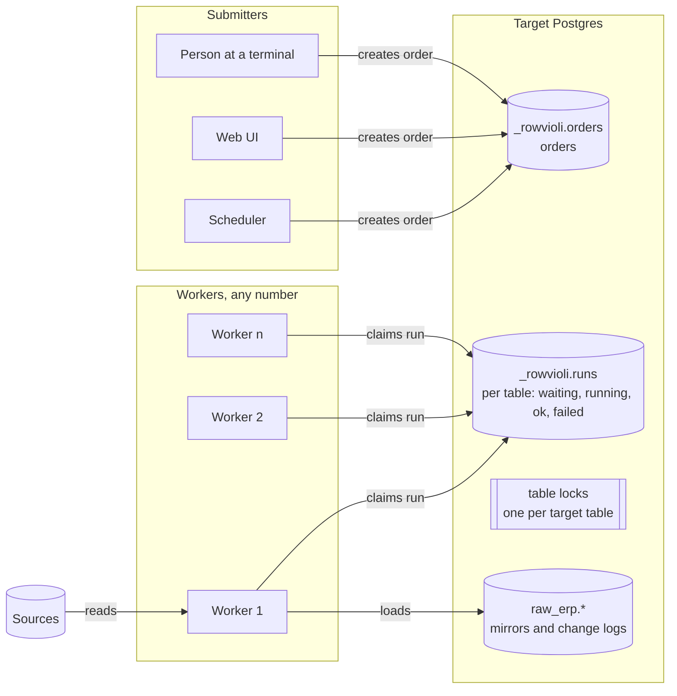
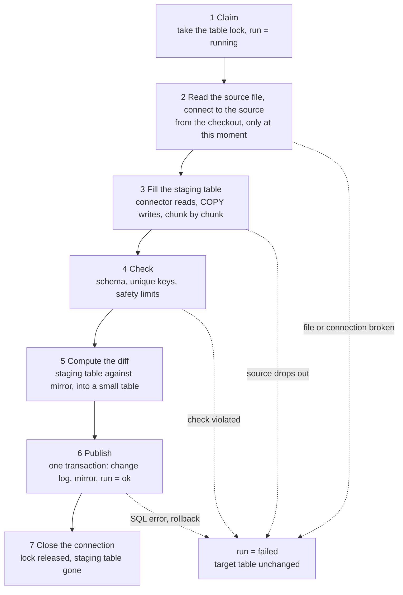
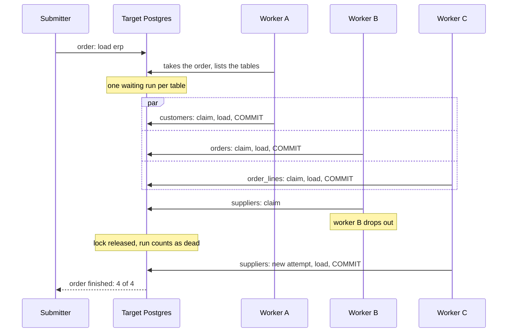
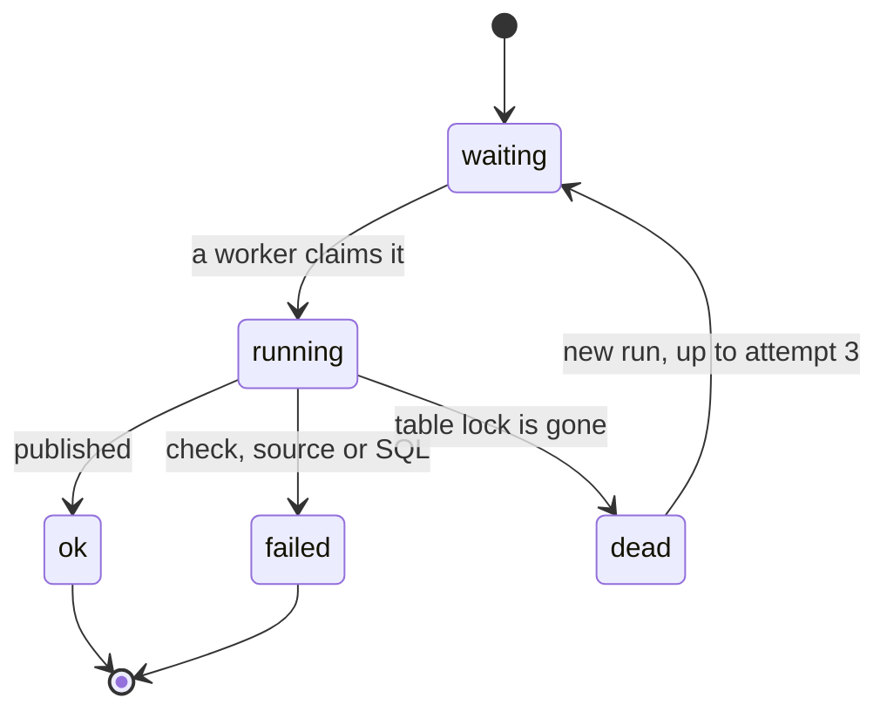
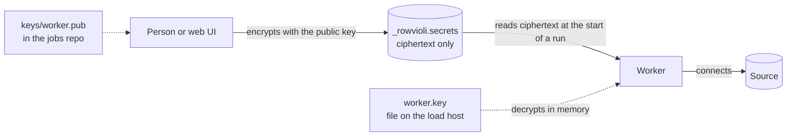

# rowvioli

> **Status 2026-11-11: concept.** There is no program yet. Measured so far: compare and publish as plain SQL, the row comparison on wide tables, the behaviour when a process is killed, and claiming by several workers. What is proven and what is not is listed in [docs/measurements.md](docs/measurements.md) and [docs/open-points.md](docs/open-points.md).

A program that mirrors tables from source systems into a PostgreSQL target. Consumers always see a complete state there. Queuing, locking, counting and monitoring happen in the target database and nowhere else.

The guiding idea: **Postgres does everything that is hard.** The program passes rows from the source to the target and triggers a few SQL statements there. It compares nothing itself and never holds a whole table in memory.

## Contents

- [Guarantees](#guarantees)
- [Overview](#overview)
- [Defining a source](#defining-a-source)
- [A run](#a-run)
- [Comparing in the target](#comparing-in-the-target)
- [Target schema](#target-schema)
- [Orders and workers](#orders-and-workers)
- [How Postgres counts](#how-postgres-counts)
- [Failures](#failures)
- [Secrets](#secrets)
- [Commands](#commands)
- [Operation](#operation)
- [Connectors](#connectors)
- [Web UI](#web-ui)
- [Measurements](#measurements)
- [Further documents](#further-documents)

## Guarantees

- **Never a half-loaded or empty state.** For every table, consumers see the state before or after a run, nothing in between.
- **Never two runs on the same target table.** This holds across machines, workers and submitters.
- **Dead runs are detected** without heartbeats or deadlines, and retried up to the third attempt.
- **Bounded memory.** Per table, a worker holds only a few chunks of a few thousand rows.
- **One flow for everything.** Initial load, follow-up load and tables without a key take the same path.

What it is not:

- Not a scheduler. Someone else decides when to load.
- Not a transformation tool. Columns arrive the way the source delivers them.
- Not a tool for targets other than PostgreSQL.

## Overview

Whoever wants a load puts an order into Postgres. Workers fetch the work themselves, table by table. Every table is loaded on its own and published in its own transaction.



Submitters and workers do not know each other. A submitter needs nothing but access to the database. A worker needs no address under which it can be reached.

The terms are defined in the [glossary](GLOSSARY.md).

## Defining a source

One file per source in the jobs repo:

```toml
# sources/erp.toml
[source]
name              = "erp"
type              = "odbc"
connection_secret = "ERP_ODBC"
target_schema     = "raw_erp"
parallel          = 4

include = ["dbo.*"]
exclude = ["dbo.tmp_*", "dbo.*_backup"]

# only what deviates from the defaults
[tables."dbo.OrderLines"]
key = ["order_no", "line_no"]
log = true
```

What follows from it:

- Every table that matches `include` and not `exclude` gets a target table in `raw_erp`.
- The key is taken from the primary key of the source unless it is overridden. It may consist of several columns.
- At most four tables of this source load at the same time, across all workers.
- The password is not in the file. `connection_secret` names the secret holding the connection string. The secret itself is stored encrypted in the target.

| Setting | Where | Default | Meaning |
|---|---|---|---|
| `name` | source | | Name of the source in orders and runs. |
| `type` | source | | Connector: `postgres`, `odbc`, `file`, `rest`, `python`, or the name of an installed connector package. |
| `connection_secret` | source | | Name of the secret holding the connection string. It is resolved when a run starts: first in the [secret store](#secrets), then as an environment variable of that name. |
| `target_schema` | source | `raw_<name>` | Schema of the target tables. A schema belongs to exactly one source. |
| `parallel` | source | 2 | Maximum number of tables of this source loading at the same time. |
| `include`, `exclude` | source | everything, nothing | Patterns for table names of the source. |
| `key` | table | primary key of the source | Columns that identify a row. Without a key the table is replaced as a whole. |
| `log` | source or table | off | Keep a change log. Needs a key. |
| `max_delete_share` | source or table | 0.5 | The run aborts if a larger share of the rows would disappear. |
| `max_seconds` | source or table | 3600 | A hanging run ends itself after this time. |

Any other key in the `[source]` section is passed to the connector unchanged, for example `url` for a REST connector.

## A run

A run loads exactly one table. It uses a single connection to the target, the control connection. On it the run holds the table lock, fills the staging table, checks, compares and publishes.



Until the COMMIT in step 6, consumers see the old state. Any abort before that leaves the target table unchanged.

If the worker dies in the middle of a step, the run stays recorded as `running`. The table lock and the TEMP tables disappear with the connection. The next worker that claims a run detects it as dead.

### How the program works

Heavily simplified:

```python
def load(run, target):                            # target = control connection, lock already taken
    source = read("sources/" + run.source + ".toml")
    chunks = connector(source).read(run.table)     # yields chunk by chunk
    target.copy_into_staging(chunks)               # writes chunk by chunk

    target.sql("check schema, keys, safety limits")
    target.sql("compute the diff into a small table")

    target.begin()
    target.sql("diff into the change log")
    target.sql("apply diff to the mirror")
    target.sql("run = ok")
    target.commit()                                # visible from here on
    target.close()                                 # lock released
```

Data passes through the program only in the lines `read` and `copy_into_staging`. Everything else is SQL sent to the target. The program never learns which rows changed, only how many.

### Checks in step 4

| Check | Aborts if |
|---|---|
| Schema | a column is missing or has changed its type. A new column is added to the target. |
| Key | a key combination occurs twice in the staging table or a key column is null. |
| Safety limits | the source delivers zero rows, or more than `max_delete_share` of the rows would disappear. |

The safety limits keep a broken source from emptying the mirror in a perfectly consistent way.

## Comparing in the target

Staging table and mirror sit next to each other in the target. One query finds the differences and writes them into a small TEMP table. Publishing then touches only these rows.

```sql
-- deleted: in the mirror, no longer in the staging table
SELECT 'D', m.customer_no, m.name, m.city
FROM raw_erp.customers m
WHERE NOT EXISTS (SELECT 1 FROM stage s WHERE s.customer_no = m.customer_no)

UNION ALL

-- inserted or updated: in the staging table, missing or different in the mirror
SELECT CASE WHEN m.customer_no IS NULL THEN 'I' ELSE 'U' END, s.customer_no, s.name, s.city
FROM stage s LEFT JOIN raw_erp.customers m ON m.customer_no = s.customer_no
WHERE m.customer_no IS NULL
   OR ROW(s.customer_no, s.name, s.city) IS DISTINCT FROM ROW(m.customer_no, m.name, m.city);
```

- **Row comparison instead of a hash.** `IS DISTINCT FROM` compares column by column and treats nulls correctly.
- **Columns are named explicitly.** `ROW(...)` compares by position. After a column has been added, the order in mirror and staging table can differ, so the program generates the column lists by name. `ROW(s.*)` would be wrong.
- **One pass.** Postgres reads both tables once and joins them on the key. The cost grows linearly with the number of rows.
- **Composite keys** only add columns to the join condition.
- **Without a key** there is no comparison and no change log. The transaction deletes all rows of the mirror and inserts the staging table. Consumers never see an empty table in that case either.

The comparison is safe although it runs before the transaction: as long as the run holds the table lock, no other run changes the mirror.

Publishing itself:

```sql
BEGIN;
INSERT INTO raw_erp.customers__log SELECT :run, d.* FROM diff d;            -- only with log = true
DELETE FROM raw_erp.customers m USING diff d
 WHERE d._op IN ('D','U') AND d.customer_no = m.customer_no;
INSERT INTO raw_erp.customers SELECT customer_no, name, city FROM diff WHERE _op IN ('I','U');
UPDATE _rowvioli.runs SET status = 'ok', finished_at = now(), inserted = ..., updated = ..., deleted = ...
 WHERE run = :run;
COMMIT;
```

## Target schema

Per target table:

```
raw_erp.customers          mirror: columns of the source, primary key = key
raw_erp.customers__log     change log, only with log = true
  _run, _op                run and I, U or D
  ... all columns
```

Staging table and diff are TEMP tables on the control connection. They have no fixed name in the target and disappear with the connection.

Bookkeeping in the schema `_rowvioli`:

```
sources   id, name, parallel
tables    id, source, target_table, source_table, key, last_seen
orders    order_id, source, table, status, created_at, created_by
runs      run, order_id, source, table, status, attempt, step, worker,
          started_at, finished_at, rows_read, inserted, updated, deleted, reason, version
secrets   name, key_id, ciphertext, updated_at, updated_by
status    view: runs, with "dead" computed on every query from the locks actually held
meta      schema_version
```

Today's state is read from the mirror. What changed when is in the change log. Validity periods can be computed from it as a view.

Example: customer 7 moves between run 41 and 42, customer 9 is deleted.

```
mirror  raw_erp.customers        change log  raw_erp.customers__log
id | city                        _run | _op | id | city
 7 | Cologne                       40 | I   | 7  | Bonn
                                   40 | I   | 9  | Essen
                                   42 | U   | 7  | Cologne
                                   42 | D   | 9  | Essen
```

## Orders and workers



If one table fails or dies, the others are published all the same. The price of this independence: for a short time `orders` can already be new while `customers` is still old.

### Life of an order

1. **Create.** A submitter writes one row into `_rowvioli.orders`: a source and optionally a single table.
2. **List the tables.** The first free worker takes the order, asks the source for its tables, applies `include` and `exclude` and creates one waiting run per table. This happens in one transaction. If the worker dies meanwhile, the order is open again.
3. **Load.** Every worker claims waiting runs as long as it has free slots.
4. **Done.** The order is finished when none of its runs is waiting or running.

### States of a run



### Rules

- There is at most one waiting run per target table. A second order for the same table does not create another.
- If the table is loading right now, a waiting run is created and comes next. Whoever submits an order during a run therefore gets a fresh state.
- A run with status `failed` is not retried. The next order tries the table again.
- A worker has a fixed number of slots (`--slots`). It limits what this machine loads at the same time. `parallel` limits what a source has to bear at the same time.
- A worker needs one connection to the target per slot and one more for progress updates.
- **A worker claims only what it can load.** Before claiming, it looks at its checkout and at the secret store and offers only the sources for which it has the source file and can decrypt the secret. A worker that has not pulled a new source yet leaves those runs to the others.

## How Postgres counts

There is no counter that is incremented and decremented. What is counted are the locks that are actually held at this moment.

Every table lock has two numbers: that of the source and that of the target table. Postgres lists all held locks in the system view `pg_locks`. The number of tables of a source that are loading right now is the number of rows there carrying the number of that source.

```sql
BEGIN;
-- 1. Only one worker at a time may count and claim for this source.
SELECT pg_advisory_xact_lock(0, :source);

-- 2. Count: table locks of this source held in this database.
SELECT count(*) FROM pg_locks
 WHERE locktype = 'advisory' AND classid = :source AND objsubid = 2 AND granted
   AND database = (SELECT oid FROM pg_database WHERE datname = current_database());

-- 3. If the count is below parallel: take the table lock of the next waiting run.
SELECT pg_try_advisory_lock(:source, :table);
UPDATE _rowvioli.runs SET status = 'running', worker = :me, started_at = now() WHERE run = :run;

COMMIT;  -- releases only the counting lock from step 1, the table lock stays
```

- **Step 1 prevents overtaking.** Without it, two workers could read "three of four" at the same time and both take a table.
- **The count cannot drift.** If a worker dies, its lock disappears from `pg_locks` and no longer counts. Nobody has to book anything back.
- **The same view detects dead runs.** A run recorded as `running` whose table lock is missing is dead. Every worker checks this before it claims, and creates a new waiting run up to the third attempt.
- **Order when finishing.** A run first records its final status and then releases the lock. The other way round, a finished run would briefly look like a dead one.
- **Number 0 is reserved.** It marks the counting lock. Sources get numbers from 1.

The complete function as it was tried out is in [experiments/05_vergabe.sql](experiments/05_vergabe.sql). Result with 12 workers, 50 tables from two sources and the limits 4 and 2:

| Observation | Result |
|---|---|
| Highest concurrency per source | 4 and 2, exactly the limit |
| Samples above the limit (600 samples, 20 ms apart) | 0 |
| Tables with exactly one successful run | 50 of 50 |
| Table of a worker that was killed | recorded as dead, loaded by another worker as attempt 2 |

## Failures

| What happens | Consequence | Lock released after |
|---|---|---|
| Worker crashes while Postgres waits for it | transaction discarded, run dead, new attempt | under 0.3 s (measured) |
| Worker crashes while Postgres is computing a statement | as above, as soon as Postgres notices the loss | under 4 s with a connection check every 2 s (measured), otherwise when the statement ends |
| Machine or network drops out | as above, detected through TCP keepalive | about 60 s (not measured) |
| Source stops answering | the run ends itself as `failed` after `max_seconds` | right after |
| A table makes workers crash repeatedly | after three attempts the run stays dead | |
| Target Postgres is unreachable | workers wait and retry. Nothing is loaded. | |

In no case does anything half-done become visible: a COMMIT needs a command from the worker, and the worker is gone by then.

The program sets on its own connections:

- Keepalive: `keepalives_idle=30`, `keepalives_interval=10`, `keepalives_count=3`, `tcp_user_timeout=60000`
- `client_connection_check_interval = 2s`, so that Postgres looks for the client during a long statement too
- `lock_timeout` for adding a column, so that a long-reading consumer cannot block the run forever

The control connection must go to Postgres directly, not through a connection pooler in transaction mode. Two threads never share a control connection.

## Secrets

Connection strings of the sources are stored in the target, encrypted. Every worker is connected to the target anyway, so a new password reaches all of them at once.



Whoever sets a secret needs only the public key and can never read a secret back. Only a worker holds the private key.

### How it is encrypted

- **A standard construction, not a home-made one.** Secrets are encrypted as libsodium sealed boxes through PyNaCl: an X25519 key exchange with a one-time key, then authenticated encryption with XSalsa20-Poly1305. GitHub uses the same construction for repository secrets set through its API.
- **Tampering is detected.** A single flipped bit makes decryption fail.
- **Swapping is detected.** The name of the secret is encrypted together with its value. A ciphertext copied to another name is rejected.
- **Equal values look different.** Encrypting the same value twice gives two different ciphertexts.

All four were tried out in [experiments/07_geheimnisse.py](experiments/07_geheimnisse.py).

### Where the keys live

| Key | Where | Who may see it |
|---|---|---|
| Public key | `keys/worker.pub` in the jobs repo | everybody. It changes only through a merge request. |
| Private key | a file on each load host, named by `ROWVIOLI_KEY_FILE`, mode 600 | the service user of the worker |

- The private key is never in the database, never in Git, and never passed as the value of an environment variable.
- The public key is taken from the jobs repo, not from the database. Someone with write access to the database therefore cannot slip in a key of their own.
- A worker can hold several private keys, which is what makes rotation possible.

### What happens to the decrypted value

- It exists only in the memory of the worker, for the duration of a run.
- It is never written to `_rowvioli.runs`, to the answer on stdout or to a log.
- Database drivers like to quote the connection string in error messages. The program removes the secret from every error text before it stores or prints it.

### Rotation and loss

1. `rowvioli key new` creates a new pair.
2. The new private key is added to every load host, next to the old one.
3. The new public key replaces the old one in the jobs repo.
4. `rowvioli secret rekey`, run on a load host, re-encrypts all secrets.
5. The old private key is removed.

If the private key is lost, the secrets cannot be recovered and have to be set again.

### What this protects against, and what not

| Situation | Protected |
|---|---|
| Someone reads the database, a backup or a replica | yes, they see ciphertext only |
| Someone with write access changes or swaps a ciphertext | yes, decryption fails |
| The web UI or a person setting secrets is compromised | yes for existing secrets, they cannot be read back |
| A load host is compromised | **no**. It holds the private key and a database connection and can read every secret. |
| Someone with write access puts back an older ciphertext of the same name | **no** |

The encryption will not be the weak point. The private key file is. Two measures limit the damage if a load host is taken over: accounts in the source systems that may only read, and as few people as possible who can log in to a load host.

### Without the secret store

If the store has no entry for a name, the program uses the environment variable of that name. Whoever already has a secret manager that injects variables can keep using it.

## Commands

| Command | Does | Needs |
|---|---|---|
| `rowvioli init` | Creates the schema `_rowvioli` in the target. | target Postgres |
| `rowvioli key new` | Creates a key pair: a private key file for the workers and a public key for the jobs repo. | nothing |
| `rowvioli secret set ERP_ODBC` | Asks for the value, encrypts it with the public key and stores it. | jobs repo, target Postgres |
| `rowvioli check erp` | Shows which tables match and with which key. Loads nothing. | jobs repo, source |
| `rowvioli submit erp` | Creates an order. With `--wait` it waits for the order to finish. | target Postgres |
| `rowvioli submit erp dbo.Customers` | Order for a single table. | target Postgres |
| `rowvioli work --slots 4` | Runs permanently, claims waiting runs and loads up to four tables at a time. | jobs repo, sources, target Postgres |
| `rowvioli run erp` | Creates the order and works it off in the same process. Claims only runs of this source and ends with the order. | jobs repo, source, target Postgres |

Answer of `run` and `submit --wait` on stdout:

```json
{"order": 17, "source": "erp", "seconds": 41.2,
 "tables": {
  "raw_erp.customers": {"status": "ok", "inserted": 12, "updated": 3, "deleted": 1},
  "raw_erp.suppliers": {"status": "failed", "step": "check",
                        "reason": "62 % of the rows would be deleted"}}}
```

| Exit code | Meaning |
|---|---|
| 0 | No table of the order failed. |
| 1 | At least one table failed or is finally dead, or the source file is broken. The other tables are published. |

There is no code for "already running". A duplicate order queues up instead of being rejected.

A submitter without the program installed creates the order as SQL:

```sql
INSERT INTO _rowvioli.orders (source) VALUES ('erp');
```

## Operation

The same mechanism in three sizes:

| Size | Commands | What is added |
|---|---|---|
| One machine | `rowvioli run erp` | The scheduler starts this one command. No service, no second machine. |
| One worker as a service | `rowvioli work --slots 4` and `rowvioli submit erp --wait` | The scheduler does not have to run on the load host and needs only access to the database. |
| Several workers | `rowvioli work --slots 4` on more machines | Nothing else changes. |

### The jobs repo

```
etl-jobs/
  sources/
    erp.toml
    crm.toml
    files.toml
  connectors/        custom connectors
    weather.py
  schedule/          the schedule in the scheduler's own format
    crontab
  bin/run            start scripts
  bin/work
  keys/worker.pub    public key for encrypting secrets
  pyproject.toml     names the program as a dependency
  uv.lock            pins its version
```

- A merge request is the only way to change a source. CI runs `rowvioli check` on it.
- The schedule lives in the same repo, in the scheduler's own format. The program never reads it.
- Program version and source files are in the same commit.
- Every run records the commit id of the checkout it ran with.

### A load host

To be set up once: Git, uv and the vendors' ODBC drivers.

```
/opt/etl-jobs        checkout of the jobs repo
/etc/etl/env         ROWVIOLI_TARGET_URL and ROWVIOLI_KEY_FILE
/etc/etl/worker.key  the worker's private key, readable only by the service user
```

```sh
# bin/run
#!/bin/sh
set -e
cd /opt/etl-jobs
. /etc/etl/env
exec uv run rowvioli run "$1"
```

```ini
# systemd service for a worker
[Service]
User=etl
ExecStart=/opt/etl-jobs/bin/work
Restart=always
```

```
# update, every five minutes
*/5 * * * *  git -C /opt/etl-jobs pull -q --ff-only
```

- The scheduler calls `/opt/etl-jobs/bin/run erp`. If it runs on another machine, it does so over SSH or creates the order directly in the database.
- The scheduler manages no secrets.
- **Source passwords are not on the load host.** They are in the secret store in the target and are decrypted when a run starts. A new source needs no change on any load host and no restart, whether the worker runs on a machine or in a container.
- Test and production are separate machines with the same repo, a different `env` file and different keys.
- Whoever runs containers anyway can build an image from the jobs repo. It is not required.

### Deploying while loads are running

A deployment is a `git pull`. It ends no process.

| Change | Running tables | Takes effect from |
|---|---|---|
| New or changed source file | keep running untouched | the next table a worker starts. No restart. |
| New custom connector | keep running untouched | the next table of that source. No restart. |
| New source with a new password | keep running untouched | the next claim of each worker that has pulled the source file. The password reaches all workers at once. No restart. |
| New program version | run to completion | the restart of the worker. It accepts nothing new, exits and starts with the new version. |

Program versions are installed side by side and never overwritten in place, so that a running process keeps its version.

## Connectors

The whole contract is two functions:

```python
def tables(cfg) -> list[Table]:
    """Name, optionally columns, primary key."""

def read(cfg, table) -> Iterable[Chunk]:
    """Arrow batches or lists of dicts, chunk by chunk."""
```

A connector does not deal with locks, staging, comparison, publishing, retries or parallelism. It has to keep three promises: deliver in chunks instead of all at once, keep column types stable, name a unique key.

| Connector | Covers | Built on | Needed on the worker |
|---|---|---|---|
| `postgres` | PostgreSQL | ADBC | nothing |
| `odbc` | MSSQL, Informix, any ODBC source | arrow-odbc | the vendor's ODBC driver |
| `file` | CSV, Excel, Parquet, JSON files | DuckDB | access to the files |
| `rest` | JSON over HTTP | Python generator | nothing |
| `python` | anything else | your own file in the jobs repo | depends on the connector |

### Three ways to get a connector

| Way | Set-up | In the source file | Meant for |
|---|---|---|---|
| Shipped | `pip install rowvioli[odbc]` | `type = "odbc"` | The connectors in the table above. The core stays small, heavy dependencies come only on request. |
| Separate package | `pip install rowvioli-sap` | `type = "sap"` | Connectors shared by several teams or outside users. The package registers through an entry point. |
| File in the jobs repo | nothing | `type = "python"` | A single interface inside your own organisation. |

### A custom connector, complete

```python
# connectors/weather.py
import httpx
from rowvioli import Table

def tables(cfg):
    return [Table("readings", key=["station", "time"])]

def read(cfg, table):
    page = 1
    while data := httpx.get(cfg["url"], params={"page": page}).json():
        yield data        # a list of dicts
        page += 1
```

```toml
# sources/weather.toml
[source]
name   = "weather"
type   = "python"
module = "connectors.weather"
url    = "https://example.org/api/readings"
```

### Types

The column types in the target follow from the Arrow schema the connector delivers. Two places need care:

- **Types from dicts are inferred.** The program derives them from the first chunk. If a column is null throughout that chunk, or a different type shows up later, the run aborts. To avoid this, name the columns explicitly in `Table`.
- **Decimals from Postgres.** The ADBC driver reads `numeric` as text and cannot write text into a `numeric` column. The `postgres` connector therefore has to convert to `decimal128`. This was investigated in `data-extractor` (ADR-0014 there).

## Web UI

Everything a UI needs is in the target. It is a small application of its own with database access to `_rowvioli` and not part of the program.

| The UI should | From where | Possible |
|---|---|---|
| Show runs with status, duration, counts and failure reason | `_rowvioli.runs` | yes |
| Tell running, waiting and dead runs apart | `_rowvioli.status` | yes |
| Show all tables and how fresh they are | `_rowvioli.tables` and the last successful run | yes |
| Show the progress of a running run | `runs.step`, `runs.rows_read` | yes, the worker writes every few seconds |
| Show which rows a run changed | change log of the table | yes, with `log = true` |
| Show which version of the definition a run used | `runs.version` | yes |
| Load a source or table now | one row in `_rowvioli.orders` | yes |
| Cancel a run | Postgres terminates the run's control connection | yes |
| Set the password of a source | encrypt with the public key, write to `_rowvioli.secrets` | yes, without being able to read any secret |
| Show the next scheduled time | scheduler | not from the target |
| Show complete log lines | the worker's log system | not from the target |

Cancelling works because a run cannot publish anything without its control connection.

## Measurements

Short version. Set-up, all numbers and limitations are in [docs/measurements.md](docs/measurements.md).

| Case | 10⁶ rows | 10⁷ rows |
|---|---|---|
| Comparison when nothing changed | 0.5 s | 13 s |
| Computing the diff at 1 % changes | not measured | 39 s |
| Publishing at 1 % changes | not measured | 17 s |
| Compare and publish in one transaction (earlier variant) | 1.9 s | 59 s |
| Without a key: replace everything | 2.9 s | 40 s |

A table with 900 columns and 100,000 rows takes 5.7 s to compare.

In the intended working range of up to 10⁶ rows a table costs a few seconds. At 10⁷ this path is slower than `hpdl` (25 to 42 s there for the whole run including reading) and in exchange does without hashes, key ranges and partitions.

## Further documents

| File | Content |
|---|---|
| [GLOSSARY.md](GLOSSARY.md) | Terms |
| [docs/decisions.md](docs/decisions.md) | Every decision with its reason, its price and the rejected alternative |
| [docs/measurements.md](docs/measurements.md) | All measurements with set-up and limitations |
| [docs/package.md](docs/package.md) | Proposal for the package, the first version and the repo layout |
| [docs/open-points.md](docs/open-points.md) | What is undecided, unverified or unbuilt |
| [experiments/](experiments/README.md) | The scripts behind the measurements |

Sketches from the discussion (private pages, in German; command and schema are still called `etl` and `_etl` there):

- [The whole picture as a page with drawings](https://claude.ai/artifact/EgxJYvAXjTfhUVYVWe4vEh)
- [Integration in a company](https://claude.ai/artifact/TpvxQYyxDKMhwY9EXgq2Ma)
- [Flow and integration](https://claude.ai/artifact/VadCBs9SdqrodwTDqSPkSN) (older state, with exit code 75)
- [One way into the target](https://claude.ai/artifact/YWwdsQGGbop5sYkk5sMqNg) (older state, with one shared transaction)
- [Path of the job data](https://claude.ai/artifact/4jdjm3LEJpKWDfXCjUDqGb) (older state, with one file per table)
