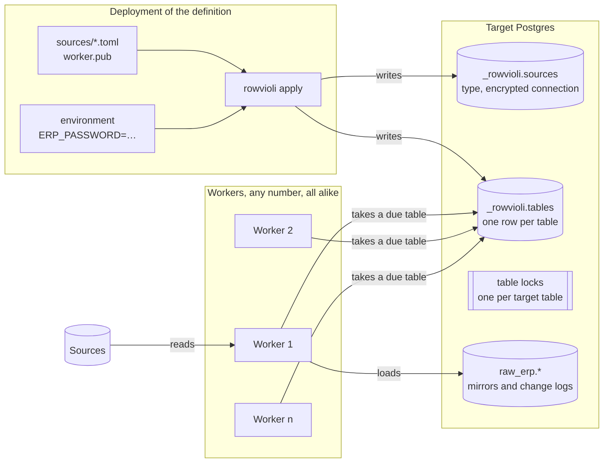
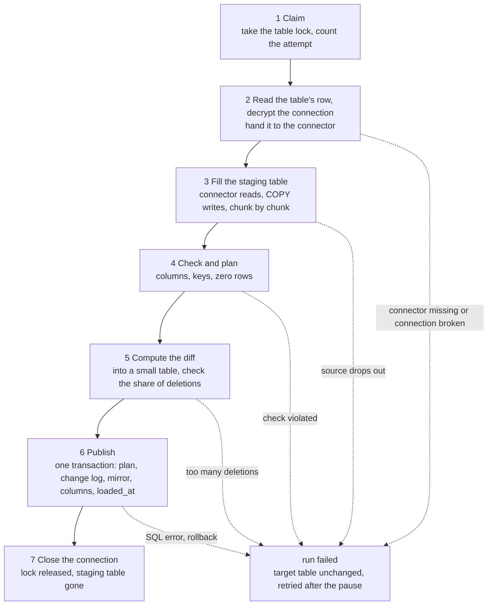
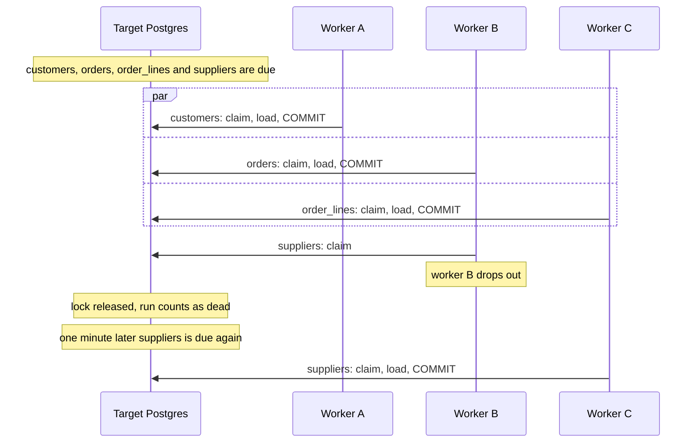
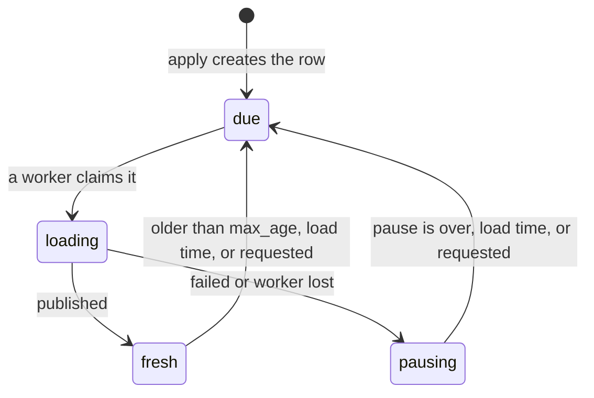

# Loading

When a table is loaded, what a run does step by step, the checks before publishing, what a person does by hand, and how workers share the work.

## Overview

The definition names every table and its maximum age. `rowvioli apply` writes it into the target. Workers know nothing but their connectors: they take the next due table from the target, load it and publish it in its own transaction.



Whoever deploys the definition needs access to the target and nothing else: no driver, no route to a source. A worker needs no checkout, no configuration file and no address under which it can be reached.

The terms are defined in the [glossary](../GLOSSARY.md).

## When a table is loaded

The target stores only facts per table. When a table is due is computed from them on every query.

| Fact | Meaning | Written by |
|---|---|---|
| `max_age` | allowed maximum age | `apply` |
| `at`, `timezone` | load times and the time zone they are meant in | `apply` |
| `loaded_at` | when the table was last published | the worker, inside the publishing transaction |
| `attempted_at` | when the last run began | the worker, when it claims the table |
| `attempts` | runs since the last success | the worker: plus one when claiming, zero on success |
| `requested_at` | when somebody asked for a load now | a person or another system |

```
due_at =  at once                       if never attempted
          requested_at                  if requested after the last run began
          loaded_at + max_age           if the last run succeeded
          attempted_at + pause          otherwise

          or the next load time after the last run began, if that is earlier
```

- **Load times.** A load time is a request the clock makes. Everything said about a request under [Loading now](#loading-now) holds for it.

- **Order.** A worker takes the table that is the most overdue measured against its own `max_age`. A five-minute table that is two minutes late overtakes hourly tables that are ten minutes late.
- **Retry.** After a run that did not succeed, the pause is one minute, then 2, 4, 8 minutes and so on, but never longer than `max_age`. A success resets it. A nightly table that fails at 02:00 is tried again at 02:01, 02:03, 02:07, 02:15, 02:31, 03:03 and so on.
- **A crash needs no bookkeeping.** The attempt was counted when the table was claimed and the success never came. The pause follows from that. A crashed worker and a failed check go through the same formula.
- **A changed `max_age`, `at` or `timezone` takes effect at once**, because nothing derived is stored.
- **All times come from the clock of the target.** Clocks of workers and callers do not matter.

A table that loads only at night still has the `max_age` of its source, and is due when that is over as well. Give the table a long one of its own:

```toml
"public.orders" = { key = ["order_no"], at = ["02:00"], timezone = "Europe/Berlin", max_age = "7d" }
```

`rowvioli status` shows it as due at the next 02:00, for example `in 4h 27m`, whatever its age.

### Loading now

For a load that should not wait, for example after the nightly batch of the ERP system has finished or after the cause of a failure has been fixed:

```sql
UPDATE _rowvioli.tables SET requested_at = now() WHERE source = 'erp';
```

`rowvioli run erp` does the same and then loads in its own process.

| Requested | Consequence |
|---|---|
| before a worker starts | one run, however often it was requested |
| while the table is loading | it loads once more afterwards, because the running read can be older than the request |
| while the table is loading, and that run fails | one more run at once, because the request was not served. Then the pause. |
| and the run that serves it fails | the normal retry with its pause takes over |
| by the clock, at load times that passed while no worker ran | one run as soon as a worker runs, however many load times passed |
| by the clock, at a load time while the table is loading | it loads once more afterwards, as in the second row |

Nobody ever resets `requested_at`. The formula only compares two points in time, so there is no flag that a worker could clear while somebody sets it.

## A run

A run loads exactly one table, in a process of its own. It uses a single connection to the target, the control connection. On it the run holds the table lock, fills the staging table, checks, compares and publishes.



Until the COMMIT in step 6, consumers see the old state. Any abort before that leaves the target table unchanged.

Three things hang on the control connection inside Postgres: the table lock, the TEMP tables and the open transaction. If the process dies in the middle of a step, Postgres removes all three. Nothing has to be cleaned up, and the run shows as dead until the retry.

### How the program works

Heavily simplified:

```python
def work(slots):                                   # the whole server
    while not sigterm_received():
        if a_slot_is_free() and something_is_claimable():   # due, within parallel and max_running
            start_process(load)                    # one process per table
        else:
            sleep(2)
    wait_for_running_processes()                   # each still ends after max_seconds

def load(target):                                  # target = control connection
    table = target.claim()                         # most overdue table: lock taken, attempt counted
    if table is None: return                       # another worker was faster

    read   = connectors[table.type].read           # the only thing a worker brings along
    chunks = read(decrypt(table.connection), table.name, table.options)
    target.copy_into_staging(chunks)               # writes chunk by chunk

    target.sql("check columns, keys, zero rows; plan what happens to the columns")
    target.sql("compute the diff into a small table, check the share of deletions")

    target.begin()
    target.sql("carry out the plan: columns that go, widen, key")
    target.sql("diff into the change log")
    target.sql("apply diff to the mirror")
    target.sql("record the columns")
    target.sql("loaded_at = now, attempts = 0")
    target.commit()                                # visible from here on
    target.close()                                 # lock released
```

Data passes through the program only in the lines `read` and `copy_into_staging`. Everything else is SQL sent to the target. The program never learns which rows changed, only how many.

`rowvioli run` is the same loop that ends when nothing is due any more.

### Checks before publishing

Step 4 compares staging table, mirror, change log, key and `renamed` and makes a plan: what the run will do to the columns besides adding new ones. Every stop that follows from a rule happens here, before anything is written. What only Postgres can find, an object of a consumer that depends on a column, stops the run in publishing, which rolls back.

| Check | Aborts if | Runs |
|---|---|---|
| Column names | a delivered column name is longer than 63 bytes, the most Postgres keeps of a name, or two are equal in their first 63 bytes. | step 3, as soon as the connector has delivered its columns, before the staging table exists |
| Columns | the plan cannot carry out what the source changed: a column is gone or of another family in a table without a change log, a column of another family is a key column or a column whose type a Parquet file brings itself, not pinned under `columns`, a column of the mirror is not in the change log, a name the change log keeps for a retired column is taken, or a stated rename cannot act. A new column is added, a column gone from a table with a change log leaves the mirror, a type of the same family is kept or widened: see [Columns](#columns) and [The stops](#the-stops). | step 4, on the filled staging table |
| Key | a key column is not in the source, a key combination occurs twice in the staging table, a key column is null, a key column is of another family than the mirror's, the key was taken away while a change log exists, or the comment on the change log's column `_op` is lost after a change of key. A key that differs from the mirror's primary key is no failure: see [Columns](#columns). | a missing key column in step 3, as soon as the connector has delivered its columns, before the staging table exists; the rest in step 4 |
| Safety limits | the source delivers zero rows while the mirror has rows and `max_delete_share` is below 1, or more than `max_delete_share` of the rows would disappear. | zero rows at the end of step 3; the share after step 5 |
| Change log | a change log exists and this run would not write to it (`log = false`, or the key was taken away), or it exists and its mirror does not. | step 4 |
| Target name | `apply` gave the table another target name, or took it out of the definition, while the run loaded. Nothing is published; a renamed table loads its new name at once (decision 53). | step 6, the last statement before COMMIT |

The share of deletions is known only from the diff, so it is checked after step 5. The safety limits keep a broken source from emptying the mirror in a perfectly consistent way. Zero rows protects a mirror that has rows. A table on its first load, or a mirror that is empty, publishes zero rows: a new empty table in the source is mirrored as an empty table. `max_delete_share = 1.0` on a table (or its source) says that every row may go, so an emptied source then gives an empty mirror (with a key, a `D` row in the change log for each row; without one, an empty table, since a table without a key is replaced as a whole and its mirror is empty when it has no rows). The reason for zero rows names this way out (decision 48). Under another key only the shrinkage of the mirror counts.

A table with a key cannot have a column `_op`, and with a change log neither `_run`, `_loaded_at`, `_valid_from` nor `_valid_to`: the diff, the change log and the history view use these names.

A change log that exists is complete, so a run that could not keep it complete fails and names the log. The program never renames or drops a table. A person does, and the next run builds anew.

#### Columns

A run changes the columns of a mirror by itself where its change log keeps what was, and stops where a person must decide. The record of every change is in [the columns table](target.md#the-columns-table).

| The source | A table with a key and a change log | Without a change log |
|---|---|---|
| a new column | added to mirror and change log | added |
| a column is gone | leaves the mirror, stays in the change log | stops |
| a type of the same family | the mirror's type stays while every value fits, else mirror and change log are widened | the same |
| a type of another family | the column goes and comes back | stops |
| another key | the mirror is replaced as a whole, the history stays | the mirror is replaced as a whole |
| a renamed column | a rename where the data prove it or `renamed` states it | a rename where `renamed` states it |

The middle column holds for a table with a key and a change log. A table with `log = false`, a table without a key and a table whose change log this run would begin have none that keeps what was.

**A column is gone.** It is dropped from the mirror and stays in the change log, which gets a `U` for every row that had a value in it, so replaying the change log still gives the mirror and the history ends the version that had the value at the moment the column went. Rows that differ only in that column are not rewritten in the mirror. The columns table notes what Postgres drops with the column without a word: its indexes, its check constraints and the grants on it. A column of a key is a changed key, below. A column that is only missing from one file, one page or one run of a file or REST table is empty there and never goes, when the change log has it: the change log says whether the column is the source's.

**A column comes back.** In the family of its old type it continues its column in the change log, and `columns__history` shows the gap. In another family it begins a new column: the change log's old column is renamed `<name>__<run>` (a retired column), keeps its values and is no longer read, and the new one takes the name.

**A type.** One test for every family: a staged value fits when it passes into the target's type and back unchanged. A column of the mirror's family keeps the mirror's type while every value fits, whatever type the source declares, so a view on the mirror does not stop a table that loads fine. When a value does not fit, mirror and change log are altered to the type that holds both (`integer` to `bigint`; more digits in a `numeric`, an integer counting as 5, 10 or 19 digits before the point; `real` and `double precision` to `double precision`; `date` and `timestamp` to `timestamp`). A source that narrows a type changes nothing in the target. A column of another family goes and comes back in the same run. The widening can rewrite mirror and change log under an exclusive lock; a worker ends a run that exceeds `max_seconds` meanwhile, and the reason says so (`ended after max_seconds = 3600 while widening "raw_shop"."items", column amount to numeric(12,4); raise max_seconds once, until a run has widened it`).

A file's types are what the file brings: text for CSV and Excel, `jsonb` for JSON, its own for Parquet, except the columns the table names under `columns`. Where the definition names the columns it is the catalog: a type under `columns` that changes to another family goes and comes back like any column, a first type given to a CSV column that was loaded as `text` too, and a column taken out of a REST table's `columns` leaves the mirror as a column a database source drops; all recorded with `by = definition`. A pin taken out of a CSV, Excel or JSON column is a change of type by the definition too: the column goes back to `text` or `jsonb` the same way. A type that a Parquet file brings itself in another family stops instead, since a Parquet file's own types can change from one file to the next: pin it under `columns`. The run keeps no memory of an earlier pin, so a pin taken out of a Parquet column stops the same, and there the way out is to drop the column. A field named under `columns` and missing from the data is empty and never goes.

**A key.** The key of the definition is compared with the primary key of the mirror as a set, after renames: the same columns in another order are the same key. A first key (a table that had none), another key and a key taken away without a change log replace the mirror as a whole under the new primary key, as a table without a key always is. A change log that exists gets a `D` for every old row and an `I` for every new one with the moment of the run, and its history view reads each stretch by its own key ([History](target.md#history)). A table without a change log begins with every row, as before. A primary key that a person changed by hand while the definition stayed is put back, and the columns table records it as `by = hand`. A key column is widened like any column.

**A rename.** One column gone and one come in the same run, of one family, is a rename in mirror and change log when the data prove it or the table says so, and no row is written. The proof is one query over the mirror's old column and the staged new one, joined by the key, over the rows whose other columns are unchanged: every such row must be equal, there must be at least 20 such rows holding at least 5 different values, the gone column must have exactly one candidate and the new one exactly one, and the new name must not be in the change log. Nothing is proven for a table without a key or a change log, for a file or REST source, where the key changes, or where a key column is of another family; a flag, a small table and two candidates are not proven, and what is not proven is a column that goes and one that comes. A column renamed and retyped within its family is a rename, and its type is fitted to the old column. The columns table gets a `D` of the old name and an `I` of the new one with `was`, and for a proof the note `proven by the data: 20 rows unchanged otherwise, 20 of them equal, 5 distinct values`. A consumer's view on the renamed column keeps working under its own column name. A rename where the data cannot prove it is stated in the definition with [`renamed`](definition.md); it acts when the old column is gone and the new has come, and does nothing while the source still delivers the old one.

Two columns that swap names, or a name reused in the run its column was renamed, are seen by nobody: every row of the two is a `U`. Where a column is renamed and a new one takes its old name in the same run the data do not prove either.

**A consumer's object** that depends on a column, a type or the key that would change stops the run. Postgres refuses, nothing is published, and the reason says which column would have changed and then Postgres's own detail, which names the object:

```
column city is gone from the source and would leave the mirror raw_erp.customers, but view reporting.by_city depends on column city of table raw_erp.customers: change or drop that, and the next run goes on
```

The same holds for a foreign key, or a view that depends on the primary key (one that groups by the key and reads other columns), when the key changes; a view that only reads the key columns does not stop it: `the key of raw_erp.customers would change from (customer_no) to (customer_no, name), but ...`. A view on a history view stops a change of any column of its table, also of one the view does not read, since the history view is dropped and created again: `the columns of raw_erp.customers change, but view names depends on view raw_erp.customers__history: change or drop that, and the next run goes on`. A consumer who wants to be asked before a column changes builds a view on it. The run goes on once the object is changed or dropped. If a consumer holds a lock on the mirror, its change log or its history view while the run tries to change them, the run asks without waiting for up to ten seconds and fails with `raw_erp.customers, its change log or its history view stayed in use for 10 s, so its columns could not change; the next run tries again`.

### The stops

Every stop gives its reason in the status view and says the way out. For `raw_erp.customers` and a column `city`:

| Reason | What it means and the way out |
|---|---|
| `column city is missing in the source; without a change log its values are nowhere else, so a person drops it: ALTER TABLE "raw_erp"."customers" DROP COLUMN "city"` | A column is gone from a table without a change log (also a file or REST table without one, where a column missing from the data stops again). Drop it as said; the next run is `ok`. A table with a change log drops it by itself. |
| `column amount has changed its type from text to numeric; without a change log its values are nowhere else, so a person drops it and the next run adds it anew: ALTER TABLE ... DROP COLUMN "amount"` | A type of another family in a table without a change log. Drop the column as said; to keep its values, copy them into a table of your own first. |
| `column amount has changed its type from text to bigint; a source without a catalog guesses its types, so pin it under columns in the table's definition; where its pin was taken out, a person drops it and the next run adds it anew: ALTER TABLE ... DROP COLUMN "amount"` | A Parquet file brings a column in another family than before, and the column is not pinned under `columns`. Pin the type, and the next run goes and comes by the definition. Where a pin was just taken out, drop the column as said instead. |
| `column id has changed its type from integer to text, a type of another family in the key, so a row before cannot be told from one after: give the table another target_table, which begins a new mirror` | A key column changes its family. The old rows cannot be told from the new ones. |
| `column memo of the mirror is not in the change log, so it is not known to be from the source; drop it from the mirror, after copying its values into a table of your own if they are to be kept: CREATE TABLE <a table of yours> AS SELECT "customer_no", "memo" FROM "raw_erp"."customers"; ALTER TABLE "raw_erp"."customers" DROP COLUMN "memo"` | A column that a person added to the mirror, or dropped from the change log, while the source does not deliver it. A run never drops or writes it. Copy its values if they are to be kept, and drop it. Adding it to the change log is no way out: the next run would take it out of the mirror as a column gone from the source, and its values with it. |
| `column city of the mirror is not in the change log, so it is not known to be from the source; the source brings a column city, which a run would write into: drop it from the mirror, after copying its values into a table of your own if they are to be kept: CREATE TABLE <a table of yours> AS SELECT "customer_no", "city" FROM "raw_erp"."customers"; ALTER TABLE "raw_erp"."customers" DROP COLUMN "city"` | The same while the source delivers a column of that name, in any family: a person's own column, or one a person dropped from the change log. Renaming it does not help, since the renamed column stops the same. After the drop the next run brings the source's column. A table without a change log cannot tell: it stops with `is missing in the source` while the source lacks the column, and loads the source's values into it once the source brings it. |
| `column amount of the mirror has the type text, of another family than the integer the source delivers, and a run does not change it back; drop it from the mirror and the next run brings it again: ALTER TABLE ... DROP COLUMN "amount"` | A person changed the mirror's type to another family. The drop works whatever values were written into the column; putting the type back fails when one does not cast. |
| `column city__812 of the source has the name under which the change log keeps the old values of city: rename that column of the change log and drop its history view, which the next run creates again: ALTER TABLE "raw_erp"."customers__log" RENAME COLUMN "city__812" TO <another name>; DROP VIEW "raw_erp"."customers__history"` | The source delivers a column named like a retired column (`<name>__<digits>` beside a log column `<name>`). Rename the one in the change log as said. |
| `column city of the change log is to keep its old values under city__812, a name that is taken` (or `longer than 63 bytes`)`: rename that column of the change log ...` | A column of another family has to retire the old one and its new name is not free, or too long. Rename the column in the change log. |
| `column city is renamed town in the table's definition, but text and integer are types of two families, so their values are not the same: take town out of renamed` | A stated rename across two families. |
| `column city is renamed town in the table's definition, but the change log has a column town already: rename that column of the change log and drop its history view, which the next run creates again: ...` | A stated rename onto a name the change log has. |
| `the definition has no key any more, the mirror's primary key is ['customer_no']: put the key back, or give the table another target_table; to load it without a key, drop the change log raw_erp.customers__log with its history view (DROP TABLE "raw_erp"."customers__log" CASCADE) and the mirror` | The key was taken away while a change log exists. The program does not end a change log. |
| `the comment on column _op of the change log raw_erp.customers__log, which says the keys it was written under, is missing or unreadable, and the key has changed: put it back, COMMENT ON COLUMN "raw_erp"."customers__log"._op IS '...'` | The comment is gone after a change of key. The reason holds the text to put back. |
| `the change log raw_erp.customers__log exists and this run would not write to it (log = false or no key): drop it with its history view (DROP TABLE "raw_erp"."customers__log" CASCADE), or rename both with the mirror` (or `and its mirror is missing`) | The change log would no longer be complete. See below. |
| `column amount cannot be added to "raw_erp"."customers": Postgres counts the columns once dropped from a table towards its 1600; rewrite the table to free them, by dump and restore` | A table has used up Postgres's 1600 columns with dropped ones. |
| `column <a name of 64 bytes> of the source is longer than 63 bytes, the most Postgres keeps of a name: give it a shorter name in the source` | Postgres keeps the first 63 bytes of a name and would cut the rest. The run stops before anything is written. A name of 63 bytes loads whole; bytes count, not characters, so `ä` counts two. |
| `columns <name>y and <name>z of the source are equal in their first 63 bytes, the most Postgres keeps of a name: give them names in the source that differ there` | Two names that Postgres would cut to one. |
| `a.csv: column amount is not integer in every row; change the value in the file, or its type under columns` | A type under `columns` that a value of the file does not take, also a first type for a CSV column. The reason names the table, the column and the type, and never the value. |
| `Binder Error: Column "zz" in REPLACE list not found in FROM clause` | DuckDB's words for a field named under `columns` that a file does not have. The read fails: the definition or the file is wrong. In a REST table such a field is empty. |

The rest of the stops are not about columns: `a key column of (customer_no) is null`, `a key combination of (customer_no) occurs twice`, `table dbo.Customers has no column customer_no; it has: ...`, `column _op is a name of the change log or the history view, so a table with a key cannot have it`, the safety limits and the target name.

### What a person does by hand

What a run does by itself is above. What is left for a person are the failures about a change log, a changed name, a table without a change log, and a column or type changed by hand, here for `raw_erp.customers`.

**The target name changed** (`apply` said so), and mirror and history should come along. Rename the three before the next run, here to `clients`:

```sql
ALTER TABLE raw_erp.customers RENAME TO clients;
ALTER TABLE raw_erp.customers__log RENAME TO clients__log;
ALTER VIEW raw_erp.customers__history RENAME TO clients__history;
```

A changed `target_schema` moves them instead, here to `hr`, with `ALTER TABLE raw_erp.customers SET SCHEMA hr;`, the same for `customers__log`, and `ALTER VIEW raw_erp.customers__history SET SCHEMA hr;`. Both change: move, then rename. The columns table follows a mirror renamed by hand: the next run closes the old name's rows and enters the columns under the new one with `by = found`.

Left alone, the old three stay where they are, and the next run builds a mirror under the new name with every row as `I`.

**`log = false` was set, the key was taken away, or the mirror was dropped.** The change log would no longer be complete. Drop it, and its view goes with it:

```sql
DROP TABLE raw_erp.customers__log CASCADE;
```

After a key taken away the old mirror has to go as well, a second statement: `DROP TABLE raw_erp.customers`; the next run builds anew and the history begins there. To keep the old history instead, rename mirror, change log and history view as above. A changed key needs none of this: the run keeps the history.

**A name with a control character from an older version.** A target may hold a table whose name has one (such a name is refused now). Give the table a clean `target_table` and run `apply`: it prints the change with `?` for the character, and the next run builds the new tables. The old tables stay, and their name cannot be typed. Find it with `\dt` in `psql`, which shows the character as `\x1B`, and write it as an identifier with Unicode escapes with the character as `\001B` (a backslash in the name is doubled). Drop the mirror and its change log, and the history view goes with the log:

```sql
DROP TABLE raw_erp.U&"c\001B[31mred" CASCADE;
DROP TABLE raw_erp.U&"c\001B[31mred__log" CASCADE;
```

**A column was dropped in the source of a table without a change log**, here `city`. The run fails with `column city is missing in the source; without a change log its values are nowhere else, so a person drops it: ALTER TABLE "raw_erp"."customers" DROP COLUMN "city"` and keeps failing until the column is dropped, since its values would be nowhere else:

```sql
ALTER TABLE raw_erp.customers DROP COLUMN city;
```

A view of a consumer's own that reads `city` makes the `DROP` fail; drop that view first and create it again afterwards. A table with a change log does this by itself, and keeps the values of `city` in its change log and history.

**A column's type was tightened after the first load of a table without a change log**, for example `columns = { amount = "decimal(10,2)" }` for a CSV column that arrived as text. The run fails and names the column and the way out:

```
2026-11-12 14:03:05 ✘ raw_shop.items               failed      0.1s  column amount has changed its type from text to numeric(10,2); without a change log its values are nowhere else, so a person drops it and the next run adds it anew: ALTER TABLE "raw_shop"."items" DROP COLUMN "amount"
```

Drop the column, and the next run adds it with the new type; its values come from the source again. A table with a change log goes and comes back by itself: the old values stay in the change log under `amount__<run>`.

**A table that was stuck before this version**, on `is missing in the source` or `has changed its type`, resolves with its first run if it has a change log, also a mirror with a `json` column from before json arrived as `jsonb`. A table without one stops as above, with its way out.

**A column or a type changed by hand in the mirror.** A column a person adds to the mirror is never dropped or written: the run stops with `is not in the change log` until the column is dropped, after its values are copied into a table of one's own if they are to be kept. A rename is no way out: the renamed column stops the same. A type widened by hand in the mirror, within its family, is followed in the change log by the next run, as a change of columns: under the lock that does not wait, and stopped by a consumer's view on the history view like any other change. A type changed by hand to another family stops the run, as in the table above, and the way out is to drop the column.

**A change log that was changed by hand.** A column a person drops from the change log while the mirror keeps it cannot be told from a person's own column: the next run stops with `is not in the change log`, and the way out is the same, the drop from the mirror. The next run records it `by = hand`. Its values in the change log are gone.

## Workers

A worker is stateless. It brings three things: its connectors, the address of the target and a key to decrypt connections. Everything else comes from the target. Scaling means starting another worker, and a crash loses nothing because nothing was kept in the worker.



If one table fails or dies, the others are published all the same. The price of this independence: for a short time `orders` can already be new while `customers` is still old.

### States of a table



None of these states is stored. They follow from the facts in the row and from the locks that are held at this moment.

### Rules

- **One process per run.** The worker starts a process for every table it loads. A hanging run is ended after `max_seconds`, and a crashing driver takes only its own table with it.
- **Three limits.** `--slots` limits what one machine loads at the same time. `parallel` limits what a source has to bear. `max_running` in `_rowvioli.meta` limits what the target has to bear. The last two are counted in the target, across all workers.
- **Connections to the target.** One per running table, plus one per worker with which it asks whether something is claimable: due, and within `parallel` and `max_running`.
- **All workers on one target are equipped alike.** A worker takes any due table. If its connector is missing or the connection cannot be decrypted, the run fails with a reason that names the worker, for example `connector "sap" is not installed on worker etl-02`. Providing the connectors is the operator's task.
- **The definition is read when a table starts.** A change made by `apply` never interrupts a running load.
