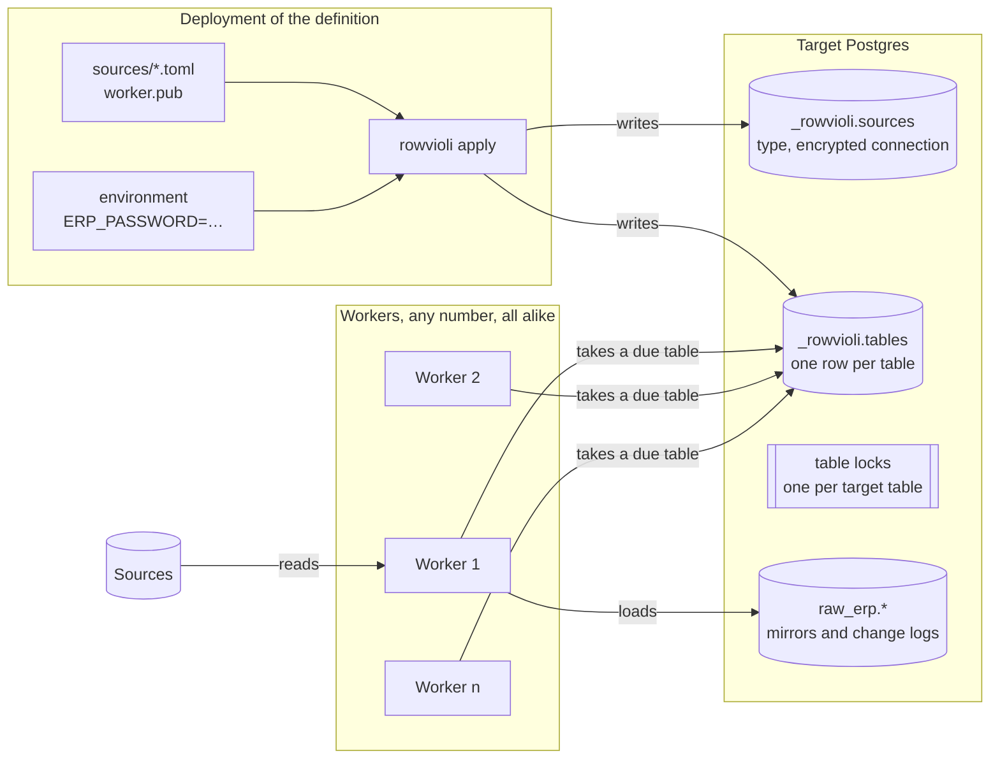
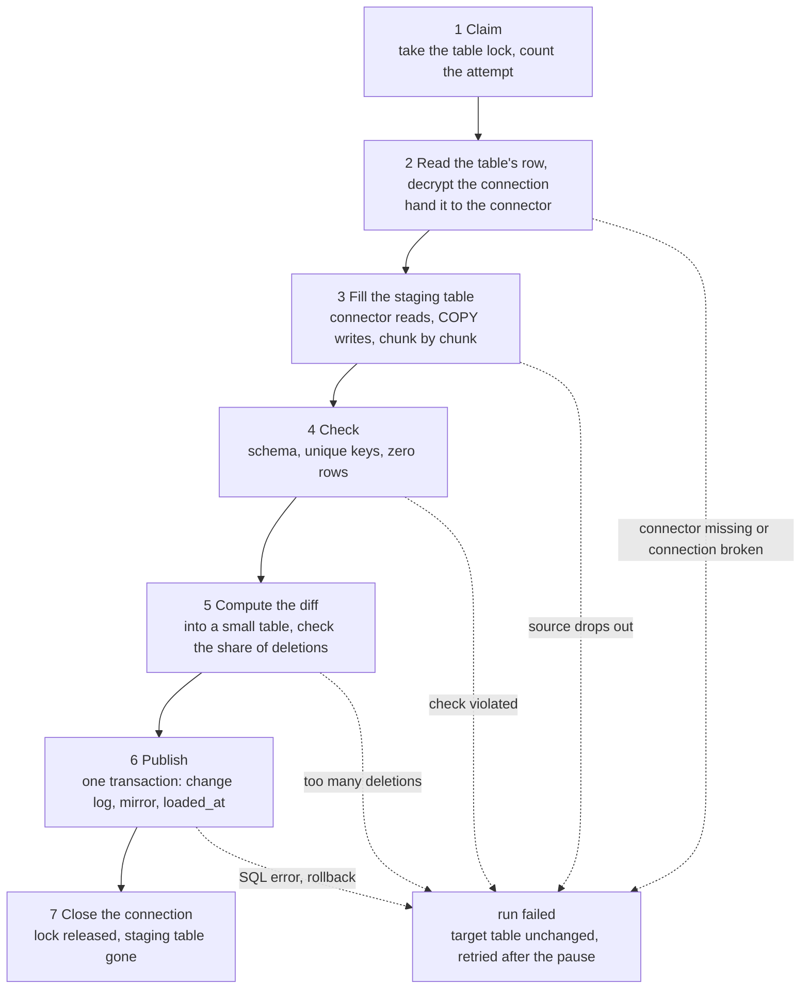
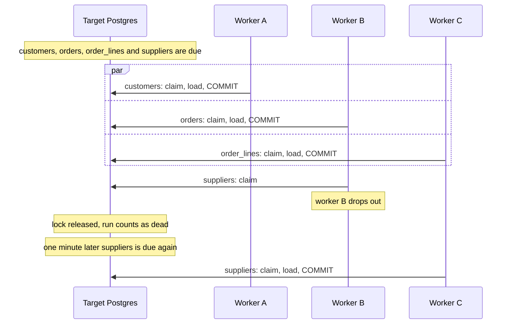
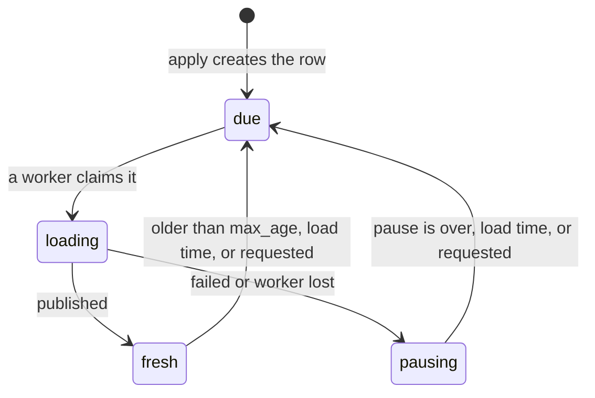

# Loading

When a table is loaded, what a run does step by step, the checks before publishing, what a person does by hand, and how workers share the work.

## Overview

The definition names every table and its maximum age. `rowvioli apply` writes it into the target. Workers know nothing but their connectors: they take the next due table from the target, load it and publish it in its own transaction.



Whoever deploys the definition needs access to the target and nothing else: no driver, no route to a source. A worker needs no checkout, no configuration file and no address under which it can be reached.

The terms are defined in the [glossary](../GLOSSARY.md).

## When a table is loaded

The target stores only facts per table. When a table is due is computed from them on every query.

| Fact | Meaning | Written by |
|---|---|---|
| `max_age` | allowed maximum age | `apply` |
| `at`, `timezone` | load times and the time zone they are meant in | `apply` |
| `loaded_at` | when the table was last published | the worker, inside the publishing transaction |
| `attempted_at` | when the last run began | the worker, when it claims the table |
| `attempts` | runs since the last success | the worker: plus one when claiming, zero on success |
| `requested_at` | when somebody asked for a load now | a person or another system |

```
due_at =  at once                       if never attempted
          requested_at                  if requested after the last run began
          loaded_at + max_age           if the last run succeeded
          attempted_at + pause          otherwise

          or the next load time after the last run began, if that is earlier
```

- **Load times.** A load time is a request the clock makes. Everything said about a request under [Loading now](#loading-now) holds for it.

- **Order.** A worker takes the table that is the most overdue measured against its own `max_age`. A five-minute table that is two minutes late overtakes hourly tables that are ten minutes late.
- **Retry.** After a run that did not succeed, the pause is one minute, then 2, 4, 8 minutes and so on, but never longer than `max_age`. A success resets it. A nightly table that fails at 02:00 is tried again at 02:01, 02:03, 02:07, 02:15, 02:31, 03:03 and so on.
- **A crash needs no bookkeeping.** The attempt was counted when the table was claimed and the success never came. The pause follows from that. A crashed worker and a failed check go through the same formula.
- **A changed `max_age`, `at` or `timezone` takes effect at once**, because nothing derived is stored.
- **All times come from the clock of the target.** Clocks of workers and callers do not matter.

A table that loads only at night still has the `max_age` of its source, and is due when that is over as well. Give the table a long one of its own:

```toml
"public.orders" = { key = ["order_no"], at = ["02:00"], timezone = "Europe/Berlin", max_age = "7d" }
```

`rowvioli status` shows it as due at the next 02:00, for example `in 4h 27m`, whatever its age.

### Loading now

For a load that should not wait, for example after the nightly batch of the ERP system has finished or after the cause of a failure has been fixed:

```sql
UPDATE _rowvioli.tables SET requested_at = now() WHERE source = 'erp';
```

`rowvioli run erp` does the same and then loads in its own process.

| Requested | Consequence |
|---|---|
| before a worker starts | one run, however often it was requested |
| while the table is loading | it loads once more afterwards, because the running read can be older than the request |
| while the table is loading, and that run fails | one more run at once, because the request was not served. Then the pause. |
| and the run that serves it fails | the normal retry with its pause takes over |
| by the clock, at load times that passed while no worker ran | one run as soon as a worker runs, however many load times passed |
| by the clock, at a load time while the table is loading | it loads once more afterwards, as in the second row |

Nobody ever resets `requested_at`. The formula only compares two points in time, so there is no flag that a worker could clear while somebody sets it.

## A run

A run loads exactly one table, in a process of its own. It uses a single connection to the target, the control connection. On it the run holds the table lock, fills the staging table, checks, compares and publishes.



Until the COMMIT in step 6, consumers see the old state. Any abort before that leaves the target table unchanged.

Three things hang on the control connection inside Postgres: the table lock, the TEMP tables and the open transaction. If the process dies in the middle of a step, Postgres removes all three. Nothing has to be cleaned up, and the run shows as dead until the retry.

### How the program works

Heavily simplified:

```python
def work(slots):                                   # the whole server
    while not sigterm_received():
        if a_slot_is_free() and something_is_claimable():   # due, within parallel and max_running
            start_process(load)                    # one process per table
        else:
            sleep(2)
    wait_for_running_processes()                   # each still ends after max_seconds

def load(target):                                  # target = control connection
    table = target.claim()                         # most overdue table: lock taken, attempt counted
    if table is None: return                       # another worker was faster

    read   = connectors[table.type].read           # the only thing a worker brings along
    chunks = read(decrypt(table.connection), table.name, table.options)
    target.copy_into_staging(chunks)               # writes chunk by chunk

    target.sql("check schema, keys, zero rows")
    target.sql("compute the diff into a small table, check the share of deletions")

    target.begin()
    target.sql("diff into the change log")
    target.sql("apply diff to the mirror")
    target.sql("loaded_at = now, attempts = 0")
    target.commit()                                # visible from here on
    target.close()                                 # lock released
```

Data passes through the program only in the lines `read` and `copy_into_staging`. Everything else is SQL sent to the target. The program never learns which rows changed, only how many.

`rowvioli run` is the same loop that ends when nothing is due any more.

### Checks before publishing

| Check | Aborts if | Runs |
|---|---|---|
| Schema | a column is missing or has changed its type, as far as the driver tells types apart (see [Types](connectors.md#types)), or holds a value its type in the target does not hold. A new column is added to the target. | step 4, on the filled staging table |
| Key | a key column is not in the source, a key combination occurs twice in the staging table, a key column is null, or the key in the definition differs from the primary key of the mirror. | a missing key column in step 3, as soon as the connector has delivered its columns, before the staging table exists; the rest in step 4 |
| Safety limits | the source delivers zero rows while the mirror has rows and `max_delete_share` is below 1, or more than `max_delete_share` of the rows would disappear. | zero rows at the end of step 3; the share after step 5 |
| Change log | a change log exists and this run would not write to it (`log = false`, or the key was taken away), or it exists and its mirror does not. | step 4 |
| Target name | `apply` gave the table another target name, or took it out of the definition, while the run loaded. Nothing is published; a renamed table loads its new name at once (decision 53). | step 6, the last statement before COMMIT |

The share of deletions is known only from the diff, so it is checked after step 5. The safety limits keep a broken source from emptying the mirror in a perfectly consistent way. Zero rows protects a mirror that has rows. A table on its first load, or a mirror that is empty, publishes zero rows: a new empty table in the source is mirrored as an empty table. `max_delete_share = 1.0` on a table (or its source) says that every row may go, so an emptied source then gives an empty mirror (with a key, a `D` row in the change log for each row; without one, an empty table, since a table without a key is replaced as a whole and its mirror is empty when it has no rows). The reason for zero rows names this way out (decision 48).

A table with a key cannot have a column `_op`, and with a change log neither `_run`, `_loaded_at`, `_valid_from` nor `_valid_to`: the diff, the change log and the history view use these names.

A change log that exists is complete, so a run that could not keep it complete fails and names the log. A changed key is never converted, and the program never renames or drops a table. A person does, and the next run builds anew.

### What a person does by hand

The failures about a change log, a changed name and a changed type end in a few statements, here for `raw_erp.customers`. A changed key needs one more, the drop of the mirror.

**The target name changed** (`apply` said so), and mirror and history should come along. Rename the three before the next run, here to `clients`:

```sql
ALTER TABLE raw_erp.customers RENAME TO clients;
ALTER TABLE raw_erp.customers__log RENAME TO clients__log;
ALTER VIEW raw_erp.customers__history RENAME TO clients__history;
```

A changed `target_schema` moves them instead, here to `hr`, with `ALTER TABLE raw_erp.customers SET SCHEMA hr;`, the same for `customers__log`, and `ALTER VIEW raw_erp.customers__history SET SCHEMA hr;`. Both change: move, then rename.

Left alone, the old three stay where they are, and the next run builds a mirror under the new name with every row as `I`.

**`log = false` was set, the key was taken away, the mirror was dropped or the key changed.** The change log would no longer be complete. Drop it, and its view goes with it:

```sql
DROP TABLE raw_erp.customers__log CASCADE;
```

After a changed key (or a key taken away) the old mirror has to go as well, the third statement: `DROP TABLE raw_erp.customers`. The next run builds anew and the history begins there. To keep the old history instead, rename mirror, change log and history view as above.

**A name with a control character from an older version.** A target may hold a table whose name has one (such a name is refused now). Give the table a clean `target_table` and run `apply`: it prints the change with `?` for the character, and the next run builds the new tables. The old tables stay, and their name cannot be typed. Find it with `\dt` in `psql`, which shows the character as `\x1B`, and write it as an escape string with the character as `\001B` (a backslash in the name is doubled). Drop the mirror and its change log, and the history view goes with the log:

```sql
DROP TABLE raw_erp.U&"c\001B[31mred" CASCADE;
DROP TABLE raw_erp.U&"c\001B[31mred__log" CASCADE;
```

**A column was dropped in the source**, here `city`. The run fails with `column city is missing in the source`, and keeps failing, since the program never drops a column. Drop it from the mirror and from the change log; the history view reads the log, so it goes first, and the next run creates it again:

```sql
DROP VIEW raw_erp.customers__history;
ALTER TABLE raw_erp.customers DROP COLUMN city;
ALTER TABLE raw_erp.customers__log DROP COLUMN city;
```

The next run is `ok`, and the log still replays to the mirror. The versions of rows that differed only in `city` now look alike in the history, and the values of `city` are gone from it. A table without a change log needs only the second statement. Not for a key column: dropping it drops the mirror's primary key, and a key column gone from the source is a changed key (above). A view of a consumer's own that reads `city` makes the `DROP` fail; drop that view first and create it again afterwards.

**A column's type was tightened after the first load**, for example `columns = { amount = "decimal(10,2)" }` for a CSV column that arrived as text. The run fails and names the column, and the mirror stays as it is, since the program never converts a column:

```
2026-11-12 14:03:05 ✘ raw_shop.items               failed      0.1s  column amount has changed its type from text to numeric
```

The same happens to a mirror with a `json` column from before json arrived as `jsonb`. The mirror and its change log have the old type, so drop both. The next run builds anew with the new type, and the history begins there:

```sql
DROP TABLE raw_shop.items__log CASCADE;
DROP TABLE raw_shop.items;
```

A table without a change log needs only the second statement. To keep the old rows, rename the old tables as above before the next run.

**A numeric column needs more digits than the mirror holds**, for example after the source went from `numeric(12,2)` to `numeric(12,4)`. The mirror keeps its type and loads while the values fit; the first that does not fails the run:

```
2026-11-12 14:03:05 ✘ raw_shop.items               failed      0.1s  column amount holds a value that its type numeric(12,2) in raw_shop.items does not hold (1.2345)
```

Widen the column in the mirror and its change log. The history view reads the log, so it goes first, and the next run creates it again:

```sql
DROP VIEW raw_shop.items__history;
ALTER TABLE raw_shop.items ALTER amount TYPE numeric(12,4);
ALTER TABLE raw_shop.items__log ALTER amount TYPE numeric(12,4);
```

A view of your own on the mirror blocks the `ALTER` as well; drop it before and create it again after. The same statements give a mirror made by 0.1.0 the source's precision and scale; it loads without them.

## Workers

A worker is stateless. It brings three things: its connectors, the address of the target and a key to decrypt connections. Everything else comes from the target. Scaling means starting another worker, and a crash loses nothing because nothing was kept in the worker.



If one table fails or dies, the others are published all the same. The price of this independence: for a short time `orders` can already be new while `customers` is still old.

### States of a table



None of these states is stored. They follow from the facts in the row and from the locks that are held at this moment.

### Rules

- **One process per run.** The worker starts a process for every table it loads. A hanging run is ended after `max_seconds`, and a crashing driver takes only its own table with it.
- **Three limits.** `--slots` limits what one machine loads at the same time. `parallel` limits what a source has to bear. `max_running` in `_rowvioli.meta` limits what the target has to bear. The last two are counted in the target, across all workers.
- **Connections to the target.** One per running table, plus one per worker with which it asks whether something is claimable: due, and within `parallel` and `max_running`.
- **All workers on one target are equipped alike.** A worker takes any due table. If its connector is missing or the connection cannot be decrypted, the run fails with a reason that names the worker, for example `connector "sap" is not installed on worker etl-02`. Providing the connectors is the operator's task.
- **The definition is read when a table starts.** A change made by `apply` never interrupts a running load.
